<div align="center">

<picture>
  <source media="(prefers-color-scheme: dark)" srcset="docs/assets/logo-dark.svg">
  
</picture>

### Zero-trust egress control for server fleets

Every outbound HTTP(S) request of your servers passes a default-deny proxy that knows **which server** asks,
**which exact path** it wants and **who approved it** — with self-service requests, change management,
threat protection and a complete audit trail.

     

[Quick start](#quick-start) · [Screenshots](#a-tour-of-the-console) · [Deployment](#deployment) ·
[Documentation](#documentation) · [Security](SECURITY.md) · [License](#license)

> **Free for noncommercial use** (personal, research, education, non-profits, evaluation).
> **Commercial use requires a license** — [get in touch](mailto:licensing@broeer.org). See [License](#license).

<br>

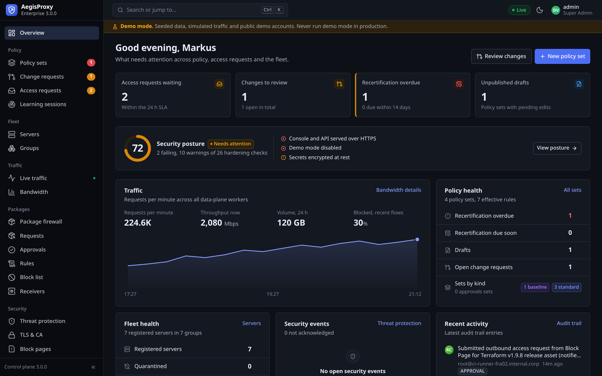

</div>

---

## Why AegisProxy

Servers rarely need "the internet" — they need a handful of package mirrors, APIs and download paths. Classic
proxies allow whole domains and leave the rest to firewall tickets. AegisProxy closes that gap:

- **Least privilege down to the path.** Rules match host *and* path (`github.com/hashicorp/terraform/releases/**`),
  methods and expiry. Redirects to CDN objects are followed precisely instead of opening the whole CDN.
- **Know the server, not just the IP.** Requests are attributed to registered servers and groups (by address or
  per-server proxy token), so policies, approvals and logs speak in terms of your fleet.
- **Self-service instead of tickets.** A blocked request shows a block page (browser) or a copy-paste message
  (CLI) with a signed block token; the responsible team approves with one click, scoped and time-limited.
- **Changes like code.** Versioned policy sets with drafts, diffs, impact simulation against real traffic,
  optional four-eyes review, recertification and one-click rollback.
- **Threat protection on every allowed request.** Threat intelligence (abuse.ch, Spamhaus, TAXII 2.1, MISP,
  Microsoft Defender), ClamAV, YARA-X, ICAP engines and DLP — fail-open or fail-closed, per policy.
- **A firewall for your dependencies.** Transparently approve npm, PyPI, NuGet and PowerShell Gallery packages:
  resolve the full dependency graph, check it against the known advisory feeds, verify signatures and provenance,
  watch behavior in a throwaway sandbox, and let only approved, hash-pinned artifacts through — with a waiting
  period for new versions and alerts when an advisory later lands.
- **Built for enterprises.** SSO and SCIM, RBAC with need-to-know, keyed hash-chained audit trail, secrets
  encrypted at rest, SIEM export, active-active HA on PostgreSQL, and installers for Kubernetes, Linux and
  Windows Server.

## How it works

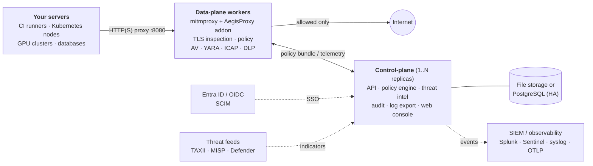

The **data-plane** is a fleet of stateless proxy workers. Each one pulls a compiled policy bundle and threat
intelligence from the control-plane, decides every request locally (no round trip per request) and streams
telemetry back. The **control-plane** is a single Go binary that serves the API and the console and stores its
state in a file (single node) or PostgreSQL (active-active). Deny is the default, and on a missing policy the
workers fail closed.

## A tour of the console

The screenshots show the console with its built-in sample data (`AEGIS_DEMO_MODE=true`), which now also
seeds the package firewall.

### Package firewall — new in 3.0

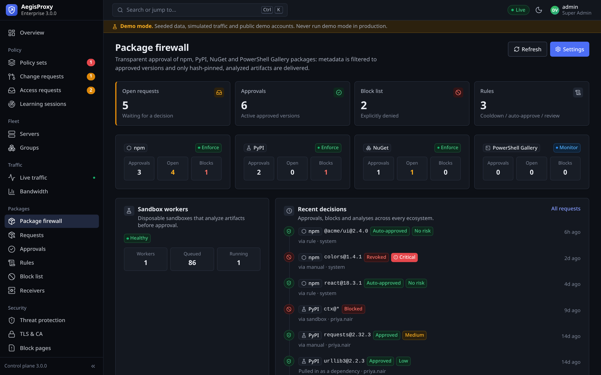

<table>
  <tr>
    <td width="50%">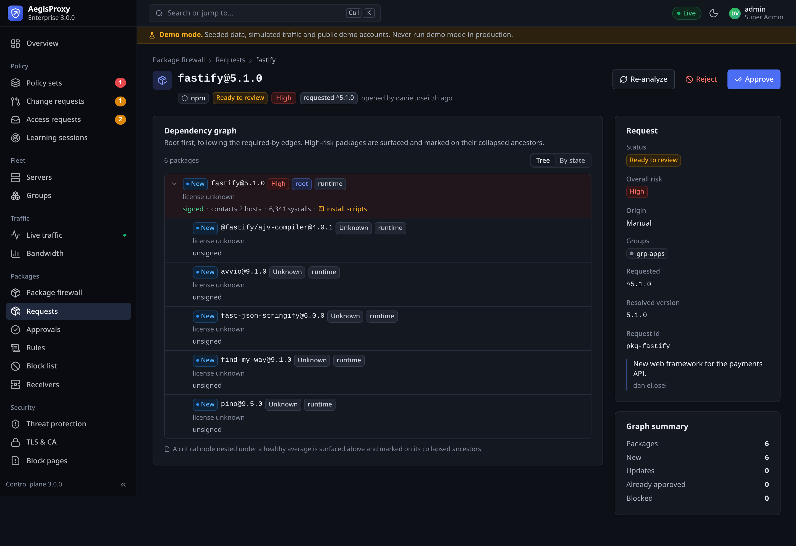<br><b>Request review</b> — the full resolved dependency graph with per-package state, risk, signatures and a sandbox summary (hosts contacted, syscalls, install scripts).</td>
    <td width="50%">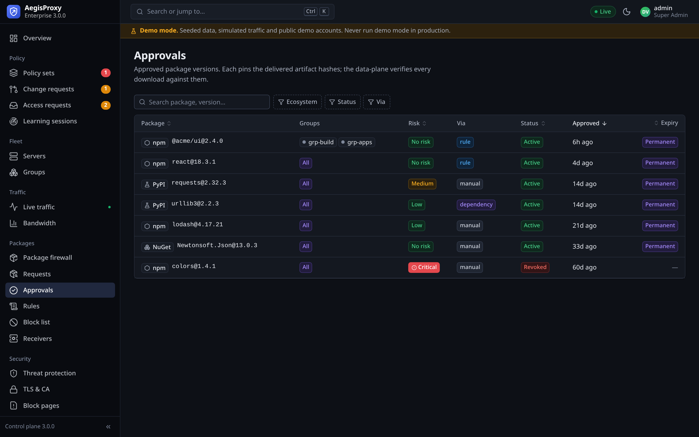<br><b>Approvals</b> — approved versions with pinned artifact hashes, risk, how they were approved (manual / rule / dependency) and expiry.</td>
  </tr>
  <tr>
    <td>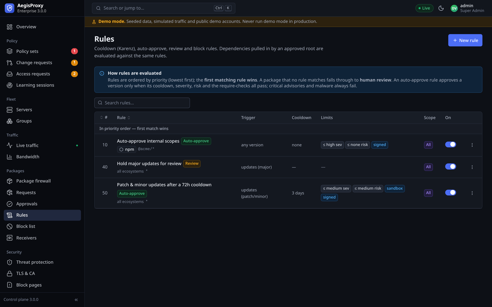<br><b>Rules</b> — ordered auto-approve / review / block rules with a cooldown (Karenz), signature and sandbox requirements.</td>
    <td>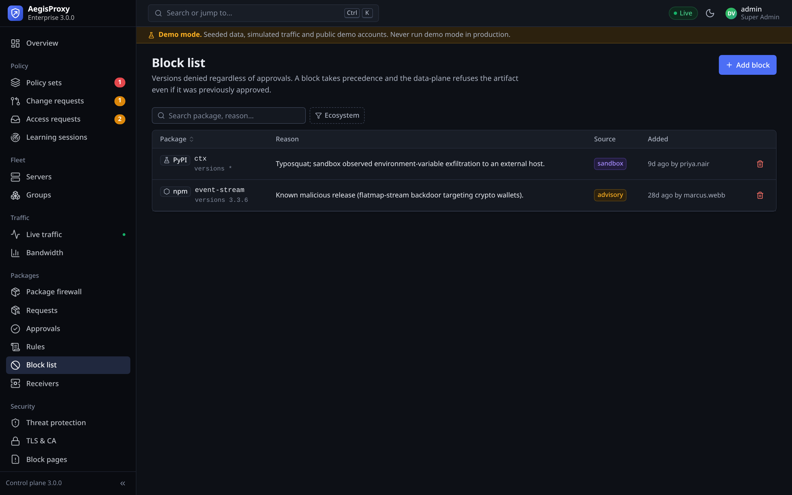<br><b>Block list</b> — versions denied regardless of approvals, with the reason and source (advisory / sandbox / manual).</td>
  </tr>
</table>

### Zero-trust egress

<table>
  <tr>
    <td width="50%">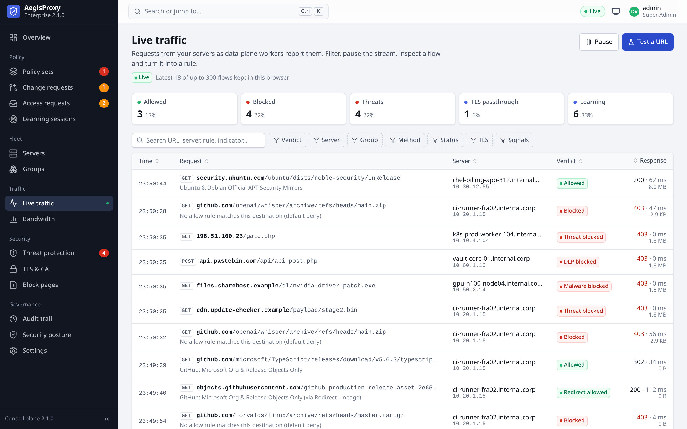<br><b>Live traffic</b> — every request with server, verdict and matched rule; turn a blocked request into a rule.</td>
    <td width="50%">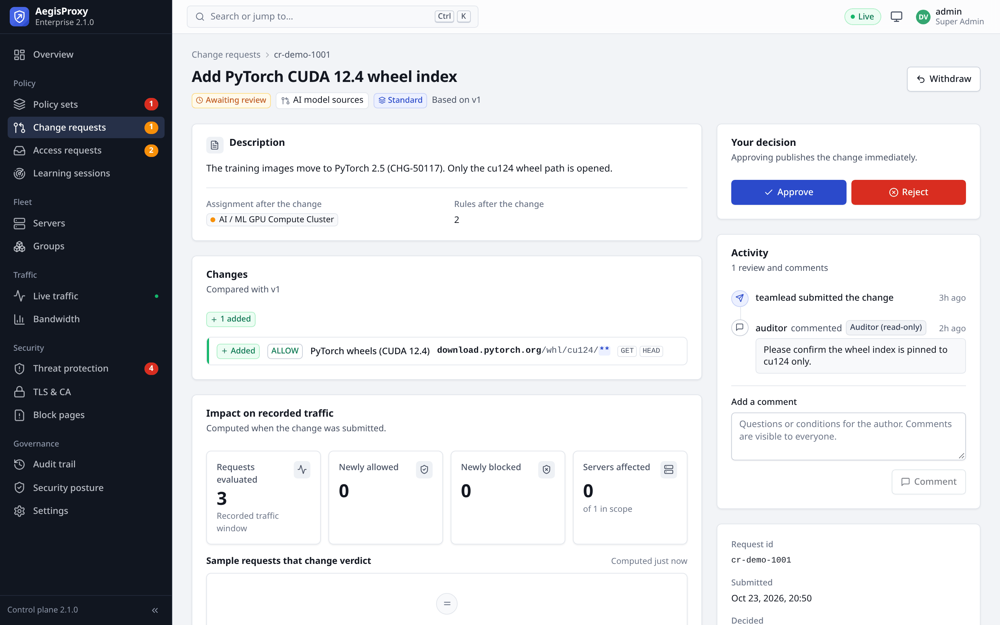<br><b>Change requests</b> — rule-level diff, impact on recorded traffic and four-eyes approval.</td>
  </tr>
  <tr>
    <td>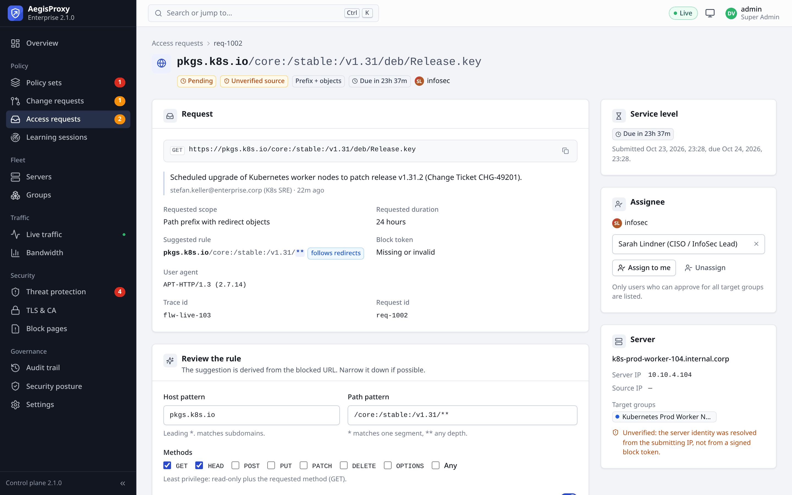<br><b>Access requests</b> — submitted from the block page or CLI, with SLA, suggested least-privilege rule and verified server identity.</td>
    <td>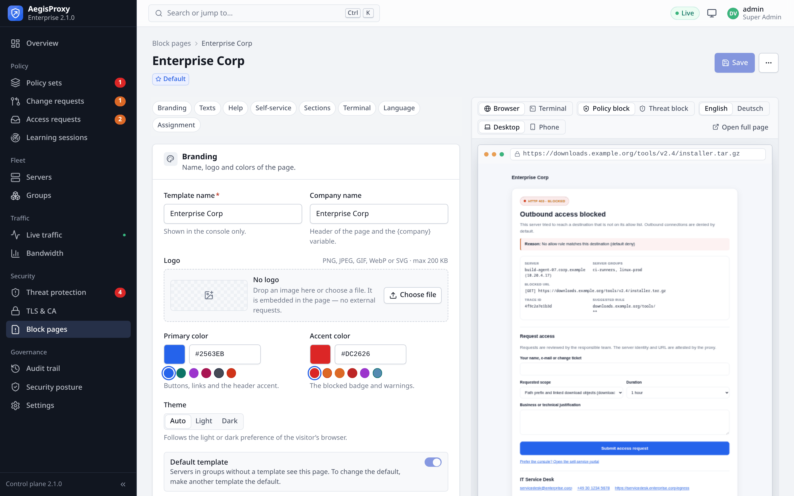<br><b>Block page designer</b> — branded pages per server group, in English and German, with live preview.</td>
  </tr>
  <tr>
    <td>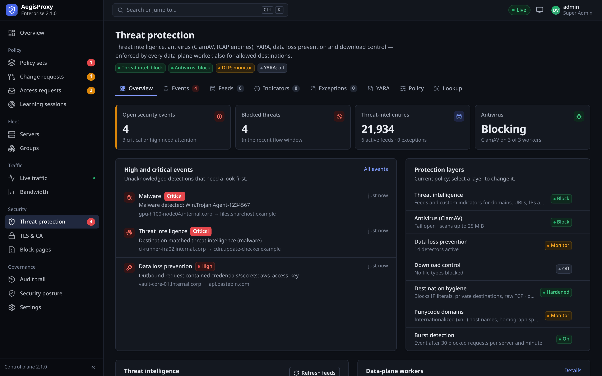<br><b>Threat protection</b> — threat intelligence, antivirus, DLP and YARA findings with protection layers at a glance.</td>
    <td>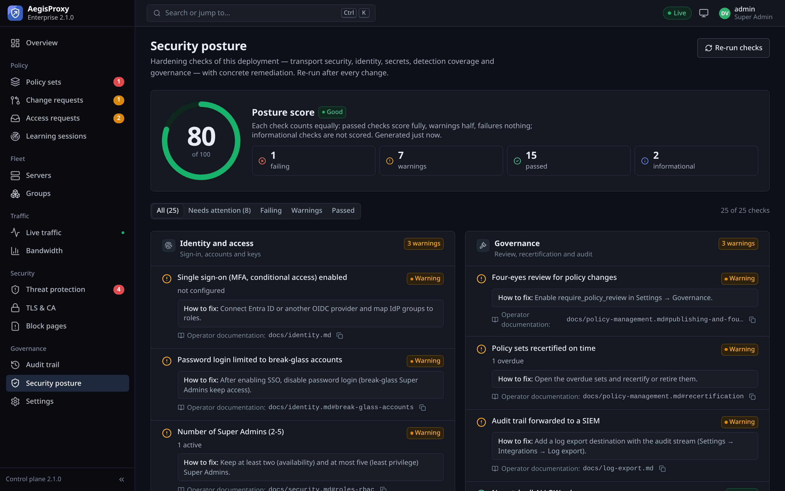<br><b>Security posture</b> — 25 hardening checks of the deployment with concrete remediation.</td>
  </tr>
  <tr>
    <td>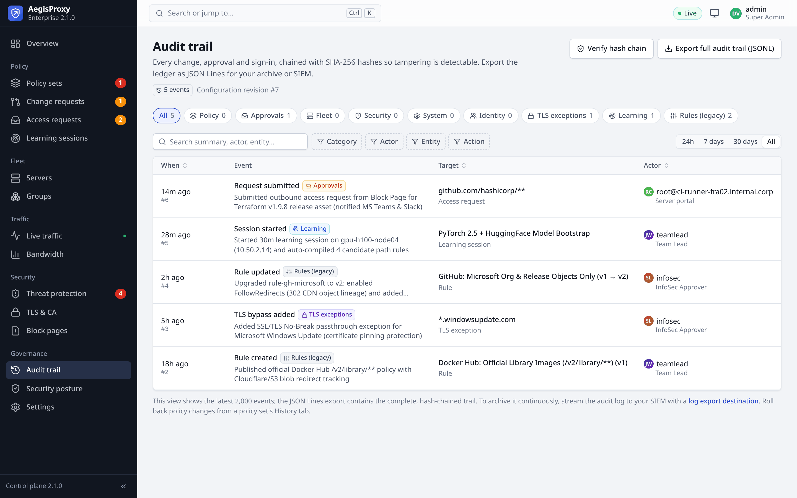<br><b>Audit trail</b> — every change and approval, hash-chained and verifiable, exportable as JSON Lines.</td>
    <td valign="top"><b>And more</b> — fleet and dynamic label groups, learning sessions that compile recorded traffic into rules, bandwidth per group, TLS exceptions, corporate PKI, single sign-on, service accounts, log export and Microsoft Defender settings.</td>
  </tr>
</table>

### What a blocked server sees

Command-line clients get a plain-text explanation they can act on, including a one-liner to request access
(output of a real request, token shortened):

```text
$ curl -x http://proxy.corp.example:8080 http://example.com/
================================================================================
 AEGISPROXY — ACCESS BLOCKED (HTTP 403)
================================================================================
 Server          : unregistered-172.24.0.1 (172.24.0.1)
 Server groups   : unassigned
 Blocked URL     : [GET] http://example.com/
 Trace ID        : flw-0dcefac7125a4ca9
 Reason          : BLOCKED — No matching whitelist rule (default deny)
--------------------------------------------------------------------------------
 REQUEST ACCESS
  In a browser:
    http://localhost:8081/?portal=block&bt=v1.eyJpcCI6…

  From this server (replace the reason):
    curl -sX POST http://localhost:8081/api/public/requests \
      -H "Content-Type: application/json" \
      -d '{"block_token":"v1.eyJpcCI6…", "requester": "root@unregistered-172.24.0.1", "reason": "ENTER_REASON_HERE", "requested_scope": "prefix_with_objects", "duration": "1h"}'
--------------------------------------------------------------------------------
 INSTALL THE ROOT CA
  Compare the installer's SHA-256 with the AegisProxy console (TLS & CA) before running it.
    Linux:   d=$(mktemp -d); curl -fsSLo "$d/aegis-ca-install.sh" http://localhost:8081/api/public/ca/install-linux.sh && sha256sum "$d/aegis-ca-install.sh"
             sudo bash "$d/aegis-ca-install.sh"; rm -rf "$d"
    Windows: $d = New-Item -ItemType Directory -Path (Join-Path $env:TEMP ('aegis-ca-' + [guid]::NewGuid())); $f = Join-Path $d.FullName 'aegis-ca-install.ps1'
             iwr -UseBasicParsing http://localhost:8081/api/public/ca/install-windows.ps1 -OutFile $f; Get-FileHash $f -Algorithm SHA256
             powershell -NoProfile -ExecutionPolicy Bypass -File $f; Remove-Item -Recurse $d.FullName
================================================================================
```

Browsers get the branded HTML block page with a request form instead.

## Features

<details open>
<summary><b>Policy and change management</b> · <a href="docs/policy-management.md">guide</a></summary>

- **Policy sets** per server group, server or the whole fleet (baseline): versioned, with owners, tags,
  priorities and recertification dates.
- **Rules** with host and path patterns, method lists, companions and expiry; deny is the default.
- **Redirect lineage**: an allowed download that redirects to a CDN object authorizes exactly that object for
  two minutes.
- **Drafts, diffs and impact simulation** against recorded traffic; optional **four-eyes review**, emergency
  publish (Super Admins, flagged in the audit), version history and rollback.
- **Learning sessions** record a reference server and compile its traffic into rules.
- **Guardrails**: Team Leads cannot remove, disable or re-scope InfoSec baselines.
- **TLS no-break exceptions** for pinned or mutual-TLS endpoints, never for strict-isolation tiers.
- **Policy as code**: export and import policy sets as drafts.
</details>

<details open>
<summary><b>Package firewall</b> (3.0, new) · <a href="docs/package-firewall.md">guide</a></summary>

- **Transparent approval** of npm, PyPI, NuGet and PowerShell Gallery packages: clients keep using the public
  registries through the proxy; the data-plane filters registry metadata down to approved versions and lets only
  approved, **hash-pinned** artifacts through. Packages are never re-hosted.
- **Full dependency graph**: a request resolves the transitive graph, shows every package with its state
  (new / update / approved / blocked) and surfaces the risky path instead of hiding it in an average score.
- **Checked against the known audit tools** (OSV and the ecosystem advisory feeds), with **signature and
  provenance verification** (npm registry signatures, Sigstore attestations, PyPI PEP 740) and license checks.
- **Behavior analysis in a throwaway sandbox** (Docker or Firecracker, no network): records every web URL, host
  and DNS name the package reaches and every system call it makes while installing and loading, plus processes,
  file writes and decoy-credential access.
- **Rules with a waiting period (Karenz)**: auto-approve new versions only once they have been public long
  enough and clear their advisory, signature and sandbox checks.
- **Periodic re-audit with alerts**: a background loop re-checks approved versions against the advisory sources,
  revokes an approval when a qualifying advisory or malware verdict lands, and alerts Slack, Teams or a webhook —
  with a one-click link to exactly which servers already pulled the affected version.
- **Incident recall**: which servers obtained a package that a later advisory flags — including gateway cache hits.
</details>

<details>
<summary><b>Self-service access requests</b></summary>

- Browser block page and CLI message with a **data-plane-signed block token**, so the requesting server is
  verified, not claimed.
- Queues with SLA, assignment, discussion, bulk review, granted durations, extension and revocation.
- Notifications to Microsoft Teams and Slack; approvals land in a group's approvals policy set.
- Branded block page templates per group, English and German, with self-service options you choose.
</details>

<details>
<summary><b>Threat protection</b> · <a href="docs/threat-protection.md">details</a></summary>

- Threat-intelligence feeds (abuse.ch, Spamhaus DROP, Emerging Threats, URLhaus and more) and custom indicators
  for domains, URLs, IPs/CIDRs and file hashes — checked on host names, URLs, **resolved IPs** and downloads.
- Your threat-intelligence platform via **TAXII 2.1** or **MISP**, and **Microsoft Defender for Endpoint**
  indicators; Defender device risk and isolation can quarantine servers at the proxy.
- **ClamAV**, **YARA** (YARA-X) and **ICAP** (RESPMOD/REQMOD) for commercial antivirus, sandbox and DLP engines;
  download control by file type; **DLP** detectors for secrets in outbound requests.
- Every content encoding is decoded with bomb limits before scanning; nothing undecodable passes.
- Protocol guard: no raw TCP through CONNECT, Host/SNI consistency (domain fronting), DNS-rebinding protection
  with IP pinning, cloud-metadata and internal ranges blocked, IP-literal and port policy.
- **Quarantine** a server in one click or automatically (Defender risk, SOAR playbooks via service accounts).
</details>

<details>
<summary><b>Identity, audit and compliance</b> · <a href="docs/identity.md">identity</a> · <a href="docs/compliance.md">compliance</a></summary>

- Single sign-on with **Microsoft Entra ID** or any OIDC provider (PKCE, client secret or `private_key_jwt`),
  group-to-role and group-to-scope mapping, **SCIM 2.0** provisioning and deprovisioning (Entra ID, Okta).
- Roles: Super Admin, InfoSec Approver, Team Lead (need-to-know on their groups), Auditor (read-only);
  alerted break-glass accounts; expiring, CIDR-bound **service accounts** for automation.
- **Keyed, hash-chained audit trail** (HMAC-SHA256) with complete export and verification; built-in rotation.
- Secrets encrypted at rest (AES-256-GCM, key rotation); interception CA as a subordinate of your corporate PKI.
- **Security posture** page with 25 hardening checks; mapping to ISO/IEC 27001, NIST SP 800-53,
  BSI IT-Grundschutz and SOC 2 with an auditor checklist.
</details>

<details>
<summary><b>Integrations and operations</b> · <a href="docs/log-export.md">log export</a> · <a href="docs/operations.md">operations</a></summary>

- **Log export** of audit, traffic and security records to syslog (rsyslog, syslog-ng, QRadar LEEF, ArcSight
  CEF), OpenTelemetry (OTLP), **Splunk HEC** (with indexer acknowledgement), Elasticsearch/OpenSearch,
  **Microsoft Sentinel** (client secret, managed identity or AKS workload identity; Azure Government and China),
  Datadog, Grafana Loki, signed webhooks and files — batched, with a durable spool (at-least-once).
- Microsoft Sentinel solution (Bicep, ASIM parsers, analytics rules, workbook, quarantine playbook) and a
  Splunk add-on with CIM mappings; Squid-format access logs on every worker.
- Active-active control-plane on PostgreSQL, stateless workers, Prometheus metrics and alert rules, health
  probes, graceful draining; OpenAPI 3.1 description of the complete API.
</details>

## Quick start

Try AegisProxy on one host with Docker Compose (Docker with the Compose plugin and `openssl`):

```bash
install -m 600 .env.example .env          # holds every secret: owner read/write only
./scripts/gen-secrets.sh >> .env          # JWT, data-plane and encryption keys
docker compose up -d --build
docker run --rm -v aegisproxy_aegis-data:/data alpine:3.22@sha256:2e0b81d60597f449baa56dc25d355367869d2dca4cd57e866f1e2b52af3eb55f \
  cat /data/secrets/initial-admin-password
```

Open **http://127.0.0.1:8081** and sign in as `admin` with that password. Change it right away (user menu or
<kbd>Ctrl</kbd>+<kbd>K</kbd> → *Change password*), then delete the file and send a first request through the
proxy on port **8080** — it is blocked, because nothing is allowed yet:

```bash
docker run --rm -v aegisproxy_aegis-data:/data alpine:3.22@sha256:2e0b81d60597f449baa56dc25d355367869d2dca4cd57e866f1e2b52af3eb55f \
  rm /data/secrets/initial-admin-password
curl -x http://127.0.0.1:8080 http://example.com/      # → 403 with the message shown above
```

Then, in the console:

1. **Groups → New group**: e.g. *Build servers* with the address range of your servers.
2. **Servers → Register** a server (host name and IP), or let requests from the group's range be attributed.
3. **Policy sets → New policy set** for the group, add an *Allow* rule such as `example.com` with path `/**`,
   and **Publish**. Workers pick it up within seconds.
4. On the server: `export https_proxy=http://<host>:8080 http_proxy=http://<host>:8080` and trust the
   enterprise CA with the installer command from **TLS & CA** (Windows: the PowerShell one next to it).
   It downloads the installer, checks its SHA-256 and only then runs it; never pipe it into a shell.
5. Watch the result in **Live traffic**; blocked requests can be requested and approved from there.

Want to look around first? Start on a fresh volume with `AEGIS_DEMO_MODE=true` for sample data (public demo
accounts such as `admin` / `admin123` — evaluation only, never in production).

> [!IMPORTANT]
> For anything beyond a test, publish the console through TLS (`AEGIS_PUBLIC_URL=https://…`), keep the
> generated secrets in a secret store and follow the hardening checklist in [docs/security.md](docs/security.md).

## Deployment

| Option | Use it for | Guide |
|---|---|---|
| Docker Compose | single host, evaluation, small sites | [docker-compose.md](docs/deployment/docker-compose.md) |
| Docker Compose HA | PostgreSQL, two control-planes, two workers behind HAProxy | [high-availability.md](docs/deployment/high-availability.md) |
| Kubernetes (Helm) | production; CloudNativePG, NetworkPolicies, PrometheusRule, workload identity; Kubernetes ≥ 1.27 | [kubernetes.md](docs/deployment/kubernetes.md) |
| Linux (systemd) | VMs and bare metal; hardened units, hash-pinned offline installs | [linux.md](docs/deployment/linux.md) |
| Windows Server | native control-plane service, worker under WinSW, console on IIS | [windows.md](docs/deployment/windows.md) |
| Separate console | console on its own host or CDN | [separate-console.md](docs/deployment/separate-console.md) |

Ports: **8080** proxy (servers), **8081** API and console (administrators, workers), **9091** worker health and
metrics. Release images (`ghcr.io/atomfritte/aegisproxy-*`) are signed with cosign and carry an SBOM
(verification: [SECURITY.md](SECURITY.md)); Docker Compose always builds the images locally. See the
[deployment overview](docs/deployment/README.md) for sizing and topologies.

## Documentation

| Topic | Document |
|---|---|
| Architecture, policy evaluation, HA design, data storage | [architecture.md](docs/architecture.md) |
| Policy sets, change management, requests, fleet, block pages | [policy-management.md](docs/policy-management.md) |
| Threat protection: threat intel, TAXII/MISP, Defender, YARA, ICAP, DLP, quarantine | [threat-protection.md](docs/threat-protection.md) |
| Identity: single sign-on, SCIM, break-glass and service accounts | [identity.md](docs/identity.md) |
| Log export to SIEM and observability platforms | [log-export.md](docs/log-export.md) |
| Configuration reference (all environment variables) | [configuration.md](docs/configuration.md) |
| Operations: rollout, monitoring, audit, backup, upgrades, key rotation, corporate PKI, troubleshooting | [operations.md](docs/operations.md) |
| Security model, encryption at rest, hardening checklist | [security.md](docs/security.md) · [SECURITY.md](SECURITY.md) |
| Threat model (STRIDE) | [threat-model.md](docs/threat-model.md) |
| Compliance mapping and auditor checklist | [compliance.md](docs/compliance.md) |
| API reference (OpenAPI 3.1) | [api.md](docs/api.md) |
| Tests and verification results | [testing.md](docs/testing.md) |

## Development

```bash
make test                 # Go (race detector), Python, console build, Helm lint
make build                # control-plane binary and console
make images               # container images
make test-installers      # Windows installers against an in-memory Windows model (Pester, Docker)
make test-windows-wine    # Windows builds under Wine, incl. PostgreSQL cluster tests (Docker)
make test-conformance     # Splunk HEC, Sentinel and public Microsoft endpoints vs. reference implementations
npm --prefix frontend run dev   # console dev server on :5173 (proxies /api to :8081)
```

Requirements: Go ≥ 1.27.3 (`control-plane/go.mod`), Python ≥ 3.12 with mitmproxy 12.3, Node.js 24, Docker. Repository layout:

```
control-plane/      Go control-plane: API, policy engine, store, threat intel, identity, export
data-plane/         mitmproxy addon (aegis_dp), entrypoint, tests
frontend/           React/TypeScript console (+ nginx image for separate hosting)
deploy/             Helm chart, Compose HA, systemd, Windows, nginx, Sentinel and Splunk packages
docs/               documentation
scripts/            secret generation, Wine and conformance harnesses, live integration tests
```

## Security

Please report vulnerabilities privately as described in [SECURITY.md](SECURITY.md). The security model, the
results of the independent review and the hardening checklist are in [docs/security.md](docs/security.md).

## License

AegisProxy is **source-available** under the [PolyForm Noncommercial License 1.0.0](LICENSE).

- ✅ **Free** for any **noncommercial** purpose — personal projects, research, education, non-profits and
  evaluation — including modifying and redistributing it under the same terms.
- 💼 **Commercial use requires a separate license.** If you (or your company) want to use AegisProxy in or for a
  business, email **[licensing@broeer.org](mailto:licensing@broeer.org)** and we'll sort out a commercial license.

Not sure which applies to you? Just ask. Third-party components bundled or run alongside AegisProxy keep their
own licenses — see [THIRD-PARTY-NOTICES.md](THIRD-PARTY-NOTICES.md). This summary is for convenience; the
[LICENSE](LICENSE) file is the binding text, and nothing here is legal advice.
