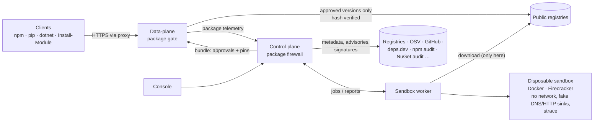

# Package firewall (3.0)

AegisProxy 3.0 approves registry packages **transparently**: developers, CI runners and servers keep using
`npm`, `pip`, `dotnet`/`nuget` and `Install-Module` against the public registries through the proxy, without a
separate repository or client reconfiguration. The data-plane, which already terminates TLS for the registry hosts,

- filters the registry **metadata** so that clients only see approved versions (the resolver picks the newest
  approved version that satisfies their range),
- delivers only **approved artifacts** and verifies each downloaded file against the hash pinned in the approval,
- reports every package request, so blocked attempts become reviewable requests and the console can answer
  which servers downloaded a version that is affected by a later advisory.

Packages are **not stored or re-hosted**. To analyze an artifact, a sandbox worker downloads it into a disposable
sandbox (Docker container without network or Firecracker microVM), inspects it, runs its install hooks and loads
it while recording every DNS name, URL, connection, process, file access and system call, and then discards the
sandbox.

> Status: this document is the design and interface contract of 3.0; sections are completed as the components
> land.

## Components



| Component | Responsibility |
|---|---|
| Data-plane (`aegis_dp/packages.py`) | Classifies registry requests, filters metadata, enforces approvals, verifies artifact hashes, reports `package` telemetry |
| Control-plane (`internal/packages`, `internal/store/packages*.go`) | Registry adapters, dependency resolution, advisory sources, signature and provenance verification, rules (cooldown / Karenz), assessments, approvals, re-audit and watch loops, API |
| Sandbox worker (`aegis-control-plane sandbox-worker`) | Claims analysis jobs, downloads and verifies the artifact, runs it in a sandbox driver (`docker`, `firecracker`), returns the report |
| Sandbox runner (`aegis-sandbox-runner`, inside the sandbox images) | Unpacks and inspects the artifact, runs the install and load scenarios under `strace` with a fake resolver and HTTP(S)/TCP sinks and bait credentials, writes the report |
| Console (`/packages…`) | Overview, catalog, request & review with the full dependency graph, analysis reports, rules, settings |

## Ecosystems

| ID | Clients | Metadata (filtered) | Artifacts (pinned) |
|---|---|---|---|
| `npm` | npm, pnpm, yarn (npm registry) | `GET /<name>` and `/@scope%2f<name>` packuments (full and abbreviated) | `/<name>/-/<file>.tgz`, `dist.integrity` (sha512) |
| `pypi` | pip, uv, poetry | `/simple/<project>/` (HTML PEP 503 and JSON PEP 691), `/pypi/<project>/json` | `files.pythonhosted.org/packages/…/<file>` (+ `.metadata`), sha256 |
| `nuget` | dotnet, nuget.exe, Visual Studio | `/v3-flatcontainer/<id>/index.json`, `/v3/registration5-*/<id>/index.json` and pages | `/v3-flatcontainer/<id>/<ver>/<id>.<ver>.nupkg` (+ `.nuspec`), packageHash (sha512) |
| `psgallery` | PowerShellGet, PSResourceGet | OData `FindPackagesById()`, `Packages(Id=,Version=)`, `Search()` | `/api/v2/package/<id>/<ver>` and the CDN `…/packages/<id>.<ver>.nupkg`, PackageHash (sha512) |

Normalized names: npm exact (`@scope/name`), PyPI PEP 503 (`[-_.]+` → `-`, lowercase), NuGet and PowerShell Gallery
lowercase. Normalized versions: npm as published, PyPI PEP 440 normalized, NuGet / PowerShell Gallery NuGet
normalized and lowercase.

## Data-plane bundle (`packages`)

The policy bundle (`GET /api/dataplane/bundle`) carries a `packages` object (absent or `enabled: false` = gate off):

```json
{
  "enabled": true,
  "console_url": "https://aegis.example.com",
  "max_metadata_bytes": 67108864,
  "max_verify_bytes": 268435456,
  "ecosystems": {
    "npm":       {"mode": "enforce", "hosts": ["registry.npmjs.org", "registry.yarnpkg.com"], "file_hosts": [], "group_ids": ["*"]},
    "pypi":      {"mode": "enforce", "hosts": ["pypi.org"], "file_hosts": ["files.pythonhosted.org"], "group_ids": ["*"]},
    "nuget":     {"mode": "monitor", "hosts": ["api.nuget.org"], "file_hosts": [], "group_ids": ["grp-ci"]},
    "psgallery": {"mode": "off", "hosts": ["www.powershellgallery.com"], "file_hosts": ["psg-prod-eastus.azureedge.net"], "group_ids": ["*"]}
  },
  "approved": {
    "npm":       {"lodash": {"4.17.21": {"g": ["*"], "files": {"lodash-4.17.21.tgz": {"sha512": "<base64>"}}}}},
    "pypi":      {"requests": {"2.32.3": {"g": ["*"], "files": {"requests-2.32.3-py3-none-any.whl": {"sha256": "<hex>"}, "requests-2.32.3.tar.gz": {"sha256": "<hex>"}}}}},
    "nuget":     {"newtonsoft.json": {"13.0.3": {"g": ["grp-ci"], "files": {"newtonsoft.json.13.0.3.nupkg": {"sha512": "<base64>"}}}}},
    "psgallery": {"psreadline": {"2.3.5": {"g": ["*"], "files": {"psreadline.2.3.5.nupkg": {"sha512": "<base64>"}}}}}
  },
  "blocked": {
    "npm": {"event-stream": {"3.3.6": "Known malicious (MAL-2018-1)"}}
  }
}
```

- `group_ids` of an ecosystem: the groups the gate applies to; `"*"` = every client, registered or not.
- `g` of a version: the groups allowed to use it; `"*"` = every client the ecosystem applies to.
- `files` are keyed by the artifact file name (lowercase for NuGet / PowerShell Gallery). A digest that is absent
  is not checked; at least one digest is always present.
- `blocked` versions are denied even when approved (`"*"` = all versions).

## Gate decisions in the data-plane

The gate runs after the ordinary evaluation (quarantine, threat intelligence, destination hygiene, explicit BLOCK
rules keep precedence and are never overridden) for requests to the hosts of an ecosystem whose mode is not `off`
and whose `group_ids` cover the client.

| Request | `enforce` | `monitor` |
|---|---|---|
| Metadata of a package with an approved version for the client | forwarded, response filtered to the approved versions (conditional headers removed, own `ETag`) | egress rules decide, unfiltered, recorded |
| Metadata of a package without an approved version | answered locally `403` (never sent upstream), recorded as `not_approved` | egress rules decide, recorded |
| Approved artifact | forwarded, body hashed and compared with the pin before the last byte is released; mismatch = `403` / connection reset and a security event | egress rules decide, recorded with digest |
| Unapproved or blocked artifact | answered locally `403`, recorded | egress rules decide, recorded |
| Service endpoint (npm keys, attestations, audit, ping; NuGet service index, vulnerability feed, repository signatures; PSGallery service document) | forwarded | egress rules decide |
| Anything else on the host (publish, login, search …) | ordinary egress rules | ordinary egress rules |

Allowed gate decisions use verdict `ALLOWED` with `matched_rule_id: "package-firewall"`; blocks use the verdict
`PACKAGE_BLOCKED`. Blocked responses are short and readable in the client's error output: JSON
`{"error": "…"}` for npm, plain text otherwise, always with the console link
`<console_url>/packages/request?ecosystem=<eco>&name=<name>&version=<version>`.

Flow records carry `package` (see `models.FlowPackage`):

```json
"package": {"ecosystem": "npm", "name": "lodash", "version": "4.17.21", "kind": "artifact",
            "decision": "approved", "filename": "lodash-4.17.21.tgz", "sha256": "<hex>", "sha512": "<base64>"}
```

`kind`: `metadata` | `artifact` | `service`; `decision`: `approved`, `filtered` (with `hidden_versions` /
`visible_versions`), `not_approved`, `blocked`, `hash_mismatch`, `monitor`, `service`.

## Sandbox workers

Workers authenticate with `X-Aegis-Sandbox-Key` (`AEGIS_SANDBOX_KEY`) and identify with `X-Aegis-Sandbox-Worker`.

| Endpoint | Purpose |
|---|---|
| `POST /api/sandbox/jobs/claim` `{"drivers": ["docker"], "ecosystems": ["npm", …]}` | `200 {"job": Job, "lease_seconds": 900}` or `204` |
| `POST /api/sandbox/jobs/{id}/heartbeat` | extends the lease |
| `POST /api/sandbox/jobs/{id}/result` `{"report": Report}` or `{"error": "…"}` | completes the job |

`Job` and `Report` are defined in `control-plane/internal/sandbox/report.go`. The runner reads one JSON line
(`RunnerInput`) followed by the artifact bytes on stdin (Docker) or from the second virtio drive (Firecracker) and
writes the report as one JSON document between the lines `AEGIS-REPORT-BEGIN` and `AEGIS-REPORT-END` on stdout
(serial console).
